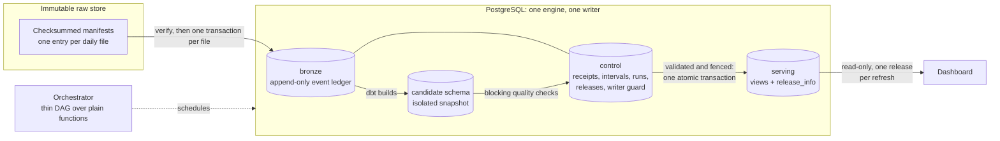

# Commerce Data Platform

A batch analytics platform whose metrics stay correct under repeated, late, corrected and failed deliveries.

## Problem

Operational teams read order, revenue and delivery metrics from a dashboard that is refreshed from daily files.
Files are delivered twice, arrive late, are corrected afterwards, and processes die half-way. The platform
guarantees that every refresh shows exactly one complete, validated, internally consistent snapshot, or keeps
showing the previous one.

## Architecture

## Data flow

1. **Raw store.** Input files are content-addressed and described by manifests with checksums and row counts.
   Stored objects are never modified.
2. **Ingestion.** Each file is verified and loaded in a single transaction that also writes a receipt. A repeated
   delivery finds its receipt and changes nothing. Events are append-only and carry a revision, so corrections are
   new revisions, not updates.
3. **Intervals.** An interval becomes complete only when every required source for it has been received.
   Processing advances only to the contiguous complete frontier.
4. **Candidate build.** dbt builds a full snapshot into a fresh, isolated schema from the latest revision of each
   entity visible at the frontier. Order money is aggregated per source before joining, so item and payment rows
   never multiply each other.
5. **Quality gate.** Blocking checks (keys, grains, reconciliation, contract) mark the candidate validated or
   rejected. A rejected candidate cannot be published; this is enforced in the database.
6. **Publication.** One transaction re-points every serving view to the validated candidate and records the
   publication. A monotonically increasing writer generation (fencing) makes any stale writer fail its next write.
7. **Serving.** The dashboard role can read the serving schema only. Each refresh reads a single release inside a
   read-only repeatable-read transaction, so it can never mix two releases.

## Invariants

- Inputs are immutable and verified by checksum before use.
- Ingestion is idempotent and transactional, with a receipt per file.
- Money is exact (`numeric`/`Decimal`); missing is `NULL`, never zero.
- Late arrivals and corrections change history deterministically; a day-by-day run equals a clean bulk load.
- Candidates are isolated; publication is atomic, validated and fenced; serving is never partially updated.
- A single writer exists at any time; takeover is an explicit, recorded administrative step.
- Orchestration is thin: the DAG declares order, pools, retries and deadlines, and calls plain, independently
  testable functions.

## Components

| Path | Role |
|---|---|
| `src/commerce/replay`, `contracts` | manifests, checksums, deterministic replay, source and payload contracts |
| `src/commerce/ingestion` | per-file transactional load, receipts, conflict and fencing checks |
| `dbt/` | staging, facts and marts built into candidate schemas |
| `src/commerce/release`, `serving` | quality gate, candidate registry, atomic publication, one-release reader |
| `src/commerce/orchestration`, `dags/` | stage functions and the Airflow DAG |
| `src/commerce/recovery`, `audit` | fault injection, backup and restore, equality and parity checks |
| `src/commerce/dashboard`, `dashboard/` | read-only data access and the Streamlit page |
| `migrations/` | forward-only, checksummed SQL migrations and role grants |

## Technology

Python 3.12, PostgreSQL 16, dbt Core, Apache Airflow 3, Docker Compose, Streamlit, pytest, ruff.

PostgreSQL is the only engine on purpose: atomic publication, privileges and fencing are database guarantees,
which keeps the consistency boundary a single system.
